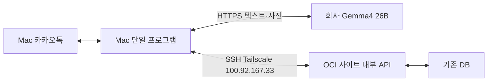

## 저장소와 로컬 경로

봇 소스의 기준 위치는 `apart` 저장소의 `kakaoBot/`이다. 이 Mac에서는 `/Users/suji/Projects/apart/kakaoBot`에 있으며 `/Users/suji/app/kakaoBot`은 이 폴더의 심볼릭 링크다. 기존 실행 명령과 설정의 절대 경로는 그대로 사용할 수 있다.

`.env.mac`, `data/`, `media/`, 로그와 `vendor/`는 로컬 전용이며 Git에 포함하지 않는다. SSH 키는 `~/.ssh`의 기존 설정을 사용한다. 다른 Mac에서는 `.env.mac.example`을 `.env.mac`으로 복사해 설정하고, 아래 명령으로 연결 도구를 준비한다.

```sh
git clone https://github.com/EricSamuelJun/mac-kakaocli vendor/kakaocli
git -C vendor/kakaocli checkout 2ec590165d96e029fad4aa9621db451ec907f01b
git -C vendor/kakaocli apply ../../deploy/kakaocli-mac-bridge.patch
(cd vendor/kakaocli && swift build -c release)
```

연결 도구의 로컬 수정은 `deploy/kakaocli-mac-bridge.patch`로 관리한다. 수정 후에는 패치도 갱신한다. 환경 설정 예제에는 실제 비밀값을 넣지 않는다.

# Mac 뽀롱봇

Mac 프로그램 하나가 카카오톡 수신·사진 원본 수신·사용자별 대화·Gemma 호출·사이트 조회/등록·답변 송신을 처리한다. `src/mac-bridge.mjs`에서 `engine.process()`를 직접 호출한다. OCI에는 기존 사이트와 DB, 봇 전용 내부 API만 필요하다. 별도 봇 HTTP 서버, Docker, Qwen 커스텀 API는 사용하지 않는다.



## 현재 검증 상태

- 이전에 완성한 테스트방 제한·정밀도 보존·사진 원본 검증·카카오 송신 확인·불명확 송신 재전송 금지를 유지했다.
- Mac에서 `gemma4:26b`가 서로 다른 합성 이미지 2장의 코드·날짜·원 개수를 정확히 읽었다. TLS 인증서 검증을 유지했다.
- 실제 Gemma 호출로 사진 전사 → 누락 질문 → 보완 답변 → 사이트 게시물 형식의 초안을 검증했다. 사진 분석도 Gemma만 사용한다.
- `npm start` 한 명령으로 프로그램과 사이트용 SSH 터널이 시작되고, 중복 실행이 차단되는 것을 확인했다.
- 자동 테스트 26개가 통과했다. 실제 운영 DB 답변·사이트 사진 등록은 **미검증**이다. 운영 OCI에 봇 API·migration·전용 작성자·공유 비밀값이 준비되지 않았다. 자세한 상태는 [INTEGRATION-VERIFICATION.md](INTEGRATION-VERIFICATION.md), 사이트 배포 요청은 [OCI-HANDOFF.md](OCI-HANDOFF.md)를 참고한다.
- 단일 사진(type=2)이 실기 검증 범위다. 사진 묶음(type=27)은 실제 스키마 검증 전까지 차단한다. 사진은 한 장씩 보내고 등록 요청으로 묶을 수 있다.

## 준비와 실행

Node.js 22.22 이상과 Mac 공식 카카오톡 앱이 필요하다. 별도 npm 패키지 설치는 없다. 작업 폴더는 `/Users/suji/app/kakaoBot`이다.

```sh
cd /Users/suji/app/kakaoBot
# .env.mac이 없을 때만 생성한다. 기존 설정 파일은 덮어쓰지 않는다.
test -f .env.mac || cp .env.mac.example .env.mac
chmod 600 .env.mac
npm run bridge:check
npm start
```

카카오톡은 공식 앱에서 로그인한다. 비밀번호를 봇에 저장하지 않는다. macOS **시스템 설정 → 개인정보 보호 및 보안 → 손쉬운 사용 / 전체 디스크 접근 권한**에서 실행 주체에 권한을 부여하고 아래 명령으로 확인한다. TCC DB를 수정하거나 권한을 우회하지 않는다.

```sh
vendor/kakaocli/.build/release/kakaocli doctor --json
```

이전 실기 검증의 실행 주체는 `/Applications/ChatGPT.app/Contents/Resources/codex-cli/CodexCLI.app`이다. Terminal이나 LaunchAgent에서 실행하면 실행 주체가 달라진다. Terminal에서는 해당 Terminal 앱, GUI LaunchAgent에서는 실제 Node 실행 파일과 `kakaocli` 실행 파일을 권한 목록에 추가할 필요가 있으며 해당 실행 문맥에서 재진단해야 한다. 손쉬운 사용이 거부되면 송신하지 못한다. Mac 잠자기·로그아웃·잠금 상태도 송신에 영향을 준다.

현재 테스트방은 `테스트오카방`, ID는 문자열 `18497328562223036`이다. Mac 로그인 계정 ID는 문자열 `162909104`다. 호출 시험은 다른 참여자 계정으로 한다. 자기 메시지는 SQL 조회 단계와 엔진에서 모두 제외한다.

`~/.kakaocli/policy.json`은 위 방 하나만 허용하며 `strictMode=true`, `denyByDefault=true`다. 엔진 허용 방과 정책 허용 방이 다르면 실행/송신을 거부한다. 정책 우회나 이름 기반 전송 옵션은 사용하지 않는다. 기존 `kakaocli` 기준 커밋은 `2ec590165d96e029fad4aa9621db451ec907f01b`이며 로컬 UI/정책 패치를 유지한다. 복원용 패치는 `deploy/kakaocli-mac-bridge.patch`에 있다.

## 설정

`.env.mac.example`과 `.env.example`은 Mac용 예제다. 실제 값은 `.env.mac`에만 둔다.

| 설정 | 의미 |
| --- | --- |
| `ALLOWED_ROOM_IDS` | 쉼표로 구분한 허용 방 ID 문자열 |
| `BOT_SENDER_ID` | Mac 로그인 사용자 ID 문자열 |
| `KAKAOCLI_BIN` | 빌드한 kakaocli 절대 경로 |
| `GEMMA_BASE_URL` | `https://gitlab.swempire.co.kr/ollama/` |
| `GEMMA_MODEL` | `gemma4:26b` |
| `APP_INTERNAL_URL` | `http://127.0.0.1:28006/api/internal/bot`만 허용 |
| `APP_BOT_SECRET` | OCI 사이트와 동일한 32자 이상 비밀값 |
| `APP_PUBLIC_URL` | `https://apart.jujeop.com` |
| `MAC_STATE_DIR` | 영속 상태 폴더, 기본 `./data/mac` |

프로그램은 `oci-heartlink-db`의 등록된 사용자·키를 재사용하되 HostName을 `100.92.167.33`으로 강제한다. 자식 SSH가 `127.0.0.1:28006 → OCI 127.0.0.1:28004`를 전달하고 끊기면 재접속한다. 공인 IP로 우회하지 않는다. 기존 SSH 연결 공유를 끄므로 다른 주소의 연결을 재사용하지 않는다. 프로그램 종료 때 자신이 실행한 SSH도 종료한다.

`deploy/mac-tunnel.sh`는 같은 터널을 수동 진단할 때만 사용한다. `npm start`와 동시에 실행하지 않는다. 이미 28006을 다른 프로세스가 점유하면 봇은 그 연결을 사용하지 않는다. 예전 28005 봇 터널과 BRIDGE_SECRET은 폐기했다.

APP_BOT_SECRET이 비어 있어도 Mac 수신·Gemma 누락 질문 검증은 가능하지만 사이트 조회/등록은 차단된다. `appConfigured=false`는 완전한 운영 준비 상태가 아니다. `bridge:check`도 OCI 배포 성공을 뜻하지 않는다.

## 대화 사용법

- 사진을 올린 다음 `@뽀롱봇 이 공고 등록해줘`라고 요청한다. 사진만으로는 AI 분석이나 사이트 등록을 실행하지 않는다.
- 같은 방·같은 발신자의 사진만 연결한다. 등록 요청 전 사진은 5분 이내, 진행 중 대화는 마지막 입력으로부터 10분 이내에만 사용한다. 사진은 최대 6장, 장당 8MiB, 합계 16MiB다.
- 공고 게시 기간, 연도, 일정 등이 부족하거나 충돌하면 질문한다. 보완 답변에도 `@뽀롱봇`을 붙인다. 공고 게시 기간과 실제 행사/작업 일정은 구분한다.
- `@뽀롱봇 취소`로 등록 대화를 중단한다. 이미 사이트에 전송한 요청은 취소를 보장할 수 없으므로 추가 생성을 막고 처리 여부를 확인해야 한다.
- `@뽀롱봇 오늘 먹거리 있어?`로 공개 게시물을 조회한다. 모델은 검색 조건만 만들며 SQL이나 DB 접속을 만들지 않는다. 공개 API 결과만 근거로 답변하고 링크를 붙인다. 예정과 현장 제보 시각을 별도로 표시한다. 확인할 자료가 없으면 없다고 답한다.
- 같은 사진의 공개 게시물이 있으면 기존 링크를 안내한다. 같은 사용자가 정확히 `@뽀롱봇 중복이어도 등록`이라고 확인한 경우에만 별도 게시물을 요청한다.
- 사이트 등록 결과가 불명확하면 `@뽀롱봇 재시도`로 저장된 동일 요청을 재시도한다. 새 사진/새 초안으로 기존 불명확 요청을 바꾸지 않는다. 24시간 넘은 미확인 요청은 운영자 확인이 필요하다.

## 영속 상태와 복구

`data/mac/mac-inbox.sqlite`는 수신 이벤트와 방별 커서를 저장한다. 처음 실행하는 방은 현재 최신 메시지를 기준으로 시작해 과거 대화를 읽지 않는다. 완료/차단/불명확 이벤트는 본문을 제거하고 ID와 상태만 남긴다.

| 수신함 상태 | 처리 |
| --- | --- |
| `pending` | 엔진 처리가 끝나지 않은 이벤트. 재시작 후 이어서 처리 |
| `done` / `ignored` | 처리 완료. 중복 이벤트를 다시 실행하지 않음 |
| `blocked` | 이미지 검증 실패·미지원 사진 묶음·잘못된 응답. 원인 확인 필요 |
| `uncertain` | 카카오 송신 직전부터 DB 확인까지 결과 불명확. **자동 재전송 금지** |

`data/mac/engine/events.sqlite`는 이벤트별 봇 답변과 등록 요청 이력을 저장한다. 일반 미완료 사진·대화는 메모리에만 있어 재시작 후 사진을 다시 요청한다. 명시적으로 등록을 요청해 사이트에 전송하는 시점에는 게시물·사진·요청 고유키를 안전한 디스크에 저장한다. 응답 유실/재시작 후 같은 요청을 재사용하기 위해서다. 완료하면 이 사진·초안은 지우고 결과만 보존한다. 서버의 BotPublication 트랜잭션/유일 키 보장이 함께 필요하다.

상태 폴더는 0700, DB·환경 파일·프로세스 잠금은 0600이다. DB 기반 프로세스 잠금은 중복 실행을 막고 비정상 종료 후 OS가 해제한다. `data/`, `media/`, `.env.mac`, 로그는 Git에서 제외한다. 카카오 내용·사진 Base64·비밀값·CDN 서명은 로그에 남기지 않는다.

```sh
npm run status
```

상태 명령은 수량, 조치가 필요한 이벤트 ID와 등록 요청 키만 출력한다. uncertain은 실제 테스트방에서 송신 여부를 확인하고 필요한 답변만 수동으로 보낸다. 상태를 무조건 pending으로 바꾸지 않는다. 등록이 성공한 뒤 답변 송신만 실패해도 등록 이력과 고유키가 유지되어 새 게시물을 만들지 않는다. 복구를 위해 상태 DB를 삭제하지 않는다. 백업은 봇을 정상 종료한 뒤 상태 폴더 전체를 안전한 위치에 보관한다.

주요 오류 코드는 `kakao-db-unavailable`, `send-policy-mismatch`, `send-uncertain`, `ai-unavailable`, `ai-response-invalid`, `tunnel-unavailable`, `tunnel-port-in-use`, `app-not-configured`, `app-auth-rejected`, `app-not-ready`, `app-unavailable`이다. 비밀값이나 전체 대화를 로그로 출력해 진단하지 않는다. AI/사이트 장애는 사용자에게 짧게 안내하며 불명확한 등록은 같은 요청으로만 복구한다.

## 자동 시작

설치 도구와 Aqua LaunchAgent 템플릿을 준비했다. 자동 시작 문맥의 카카오 권한은 별도 실기 검증이 필요하다. 운영 API와 권한을 준비한 뒤 수동 실행을 종료하고 설치한다. 이 작업 중에는 서비스 설치를 실행하지 않았다.

```sh
node scripts/service.mjs install
node scripts/service.mjs restart
# 자동 시작 해제 및 프로세스 종료
node scripts/service.mjs remove
```

라벨은 `com.village20.mac-bot`, plist는 `~/Library/LaunchAgents/com.village20.mac-bot.plist`다. Node 절대 경로를 자동 반영하며 비밀값은 plist에 넣지 않는다. 로그는 `data/mac/bot.out.log`, `data/mac/bot.err.log`다. Node 경로가 바뀌면 remove 후 install한다. foreground 실행 중에는 두 번째 프로그램이 `bot-already-running`으로 거부된다.

## 검증 명령

```sh
npm test
npm run check:ai
npm run bridge:check
```

`check:ai`는 개인 사진 대신 저장소의 합성 PNG 2장으로 Gemma의 실제 이미지 입력을 검사한다. Qwen에 접속하지 않는다. `NODE_TLS_REJECT_UNAUTHORIZED=0` 환경에서는 AI 클라이언트가 실행을 거부한다. 실제 운영 게시물 등록 검증에는 OCI API·전용 작성자·비밀값·migration 준비와 다른 참여자 계정의 테스트가 필요하다.

## 내 계정으로 사용하기

`ALLOW_SELF_COMMANDS=true`이면 로그인한 계정에서도 테스트방에 `@뽀롱봇 오늘 먹거리 있어?`처럼 입력할 수 있다. 태그 뒤에는 공백을 넣는다. 사진 등록은 같은 계정으로 개별 사진을 올린 뒤 `@뽀롱봇 이 공고 등록해줘`를 보낸다. 사진만으로 등록하지 않으며 기존 사진 만료 시간이 적용된다. 묶음 사진은 아직 지원하지 않는다.

이 모드에서는 봇 답변 앞에 `[뽀롱봇]`을 붙인다. 내 일반 대화와 이 답변은 처리하지 않아 자기 응답 반복을 막는다. 허용 방 제한과 중복 전송 방지는 그대로 적용한다. `false`로 바꾸면 자기 발신 메시지를 전부 제외한다. 설정 변경 후 프로그램을 다시 시작한다.

카카오톡 조회 답변은 최대 4건을 표시하며, 각 게시물은 제목·AI 핵심 요약(60자 이내)·링크를 한 번씩만 표시한다. 별표나 마크다운 강조는 제거한다. 공지에는 현장 제보 문구를 붙이지 않으며, 먹거리·요일장은 예정과 실제 현장 제보를 구분한다.

등록 요청은 `공고 등록.`, `공고 등록해`, `공고올려줘`, `공고올려`, `공고 업로드`, `공고등록` 등도 인식한다. 앞에 `@뽀롱봇` 태그를 붙이며, 띄어쓰기와 문장 끝 마침표·느낌표는 무관하다. 등록 방법 질문과 취소·금지 표현은 등록 명령으로 처리하지 않는다.

## 일반 대화

`@뽀롱봇 재미있는 이야기 해줘`, `@뽀롱봇 안녕` 등은 Gemma가 사이트 API 없이 직접 답한다. 답변은 400자 이내이며 최근 대화 3쌍을 같은 방·같은 사용자별 메모리에서만 10분간 유지한다. 재시작 시 초기화된다. 공고·먹거리·일정 등 실제 단지 정보는 사이트 조회로 분리하고, 명시적인 등록 및 진행 중인 보완 대화가 우선한다. 분류가 애매하면 사이트 조회를 사용한다.

## 공고 조회 범위

사이트에 저장된 `noticeKind`를 기준으로 일상공고(ROUTINE)와 단기공고(SHORT)를 구분한다. 게시 시작일부터 달력 기준 한 달 이상이면 홈페이지와 봇 모두 자동으로 일상공고로 저장한다. 예: 10/21~11/21, 1/31~2/28. 한 달 미만은 단기를 기본값으로 두며 일상공고를 직접 선택하거나 봇에게 일상공고라고 명시할 수 있다. 봇 등록 초안에도 같은 규칙을 적용한다.

기본 `@뽀롱봇 공고 알려줘`는 단기공고만, `일상공고 알려줘`는 일상공고만, `전체 공고 알려줘`는 모두 조회한다. 서버가 분류 조건을 먼저 적용해 일상공고 때문에 단기공고가 조회 제한에서 밀리지 않게 한다. 공개 여부·삭제 여부·게시 기간 필터는 유지한다. 원문이나 비밀값을 로그에 남기지 않는다.
